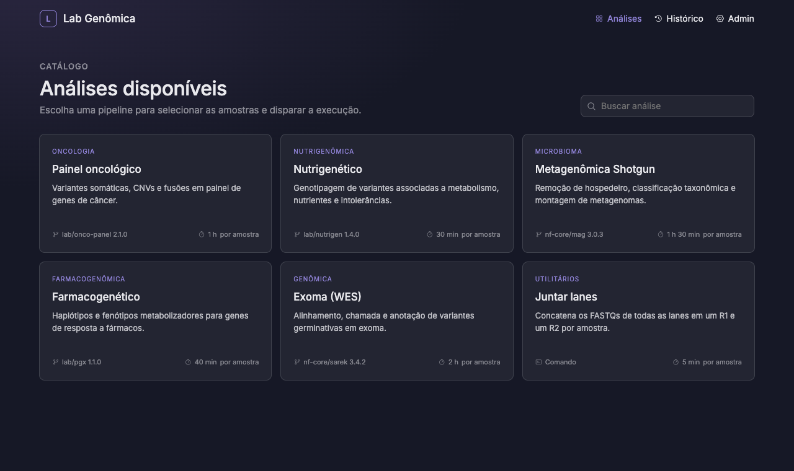

# Plataforma de Pipelines


**Dispare pipelines Nextflow e comandos de bioinformática pelo navegador, na sua própria máquina.**

Quem dispara escolhe a análise, aponta a pasta de FASTQs ou o projeto do BaseSpace, confirma as amostras e acompanha a execução pelo link da Seqera ou pelo log. Quem administra cadastra as análises, os formulários de parâmetros e a identidade visual da empresa.



## Recursos

- **Catálogo white label** com nome, logo e cor da empresa.
- **Pipelines Nextflow e comandos de shell**, como `cat` das lanes ou um script Python, na mesma fila e no mesmo histórico.
- **Identificação de amostras** a partir de uma pasta local ou de um projeto do BaseSpace, com R1 e R2 agrupados por lane.
- **Formulário de parâmetros gerado por schema JSON**, editado com pré-visualização no Admin.
- **Dois modos de execução:** uma amostra por vez ou todas ao mesmo tempo, com estimativa de tempo.
- **Execuções que não dependem da plataforma:** continuam rodando se ela cair, e o resultado é registrado na volta.
- **Acompanhamento:** link da Seqera, log ao vivo, cancelamento e retomada com `-resume`.
- **Sem dependências e sem nuvem:** só Node.js. O banco é um SQLite local.

## Início rápido

**Requisitos:** Node.js 24 ou superior. Para pipelines, também Nextflow com um Java compatível.

```sh
git clone git@github.com:brunapilotto/BioinformaticsPlatform.git
cd BioinformaticsPlatform
npm start
```

Abra <http://127.0.0.1:4173> e siga a [primeira configuração](#primeira-configuração).

Para testar de ponta a ponta sem Docker nem dados reais, cadastre uma análise com a pipeline `examples/stub-pipeline`, **Modo stub** ligado e perfil vazio.

<details>
<summary>Tudo o que a plataforma pode usar</summary>

| Item | Para quê | Obrigatório |
|---|---|---|
| Node.js 24 ou superior | Rodar a plataforma | Sim |
| Nextflow e Java compatível | Executar pipelines | Para pipelines Nextflow |
| Token da Seqera | Gerar o link de acompanhamento | Para ter o link |
| CLI `bs`, autenticada com `bs auth` | Usar projetos do BaseSpace | Para usar o BaseSpace |
| Docker ou similar | Pipelines com perfil de contêiner | Conforme a pipeline |

</details>

### Variáveis de ambiente

| Variável | Padrão | Uso |
|---|---|---|
| `PORT` | `4173` | Porta do servidor |
| `PLATAFORMA_DATA` | `data/` | Pasta do banco, das execuções e dos downloads |

```sh
PORT=8080 PLATAFORMA_DATA=/srv/plataforma npm start
```

A plataforma só aceita acessos desta máquina e não tem login, então qualquer pessoa usando o computador consegue abrir o Admin.

## Primeira configuração

No **Admin**:

1. **Identidade visual:** nome da empresa, logo e cor de destaque.
2. **Conexões › Execução local:** caminho do Nextflow e `JAVA_HOME`, se necessário. Confira com **Testar Nextflow**.
3. **Conexões › Seqera Platform:** token, URL da API e ID do workspace (opcional). Confira com **Testar conexão**.
4. **Conexões › Illumina BaseSpace:** caminho da CLI e **Verificar funcionamento**, que roda `bs whoami`. Sem essa verificação, a busca no BaseSpace fica bloqueada na tela de disparo.
5. **Análises:** revise os exemplos e cadastre as suas. Os exemplos `lab/*` não existem de verdade e devem ser trocados ou excluídos.

## Cadastrar análises

Cada análise é uma **pipeline Nextflow** ou um **comando**, mais um **schema JSON** que define o formulário de disparo.

### Schema

```json
{
  "fields": [
    {
      "key": "input",
      "type": "samples",
      "label": "Amostras",
      "sources": ["local", "basespace"],
      "pattern": "*_R{1,2}_001.fastq.gz",
      "paired": true,
      "sheet": { "columns": { "sample": "{sample}", "fastq_1": "{r1}", "fastq_2": "{r2}" } }
    },
    { "key": "data_type", "type": "select", "label": "Tipo de dado", "required": true, "options": ["WES", "WGS"], "default": "WES" },
    { "key": "outdir", "type": "folder", "label": "Pasta de resultados", "required": true, "default": "/data/resultados/{analysis}/{date}" }
  ]
}
```

| | Valores |
|---|---|
| **Tipos** | `samples`, `folder`, `file`, `select`, `genome`, `text`, `number`, `boolean` |
| **Propriedades** | `key`, `type`, `label`, `help`, `required`, `default`, `options`, `placeholder` |
| **Em `default`** | `{date}` vira a data do disparo e `{analysis}`, o identificador da análise |

**Campo `samples`:** obrigatório e único em pipelines. Em comandos, é opcional.

| Propriedade | Efeito | Padrão |
|---|---|---|
| `sources` | Origens aceitas: `local`, `basespace` | As duas |
| `pattern` | Filtro pelo nome do arquivo; aceita `*`, `?` e `{a,b}` | Qualquer FASTQ |
| `paired` | Com `false`, aceita amostras single-end | `true` |
| `sheet.columns` | Colunas do samplesheet; aceita `{sample}`, `{lane}`, `{r1}`, `{r2}` e texto fixo | `sample,fastq_1,fastq_2` |

O samplesheet gerado tem uma linha por lane e vai para a pipeline no parâmetro com a `key` desse campo. Se a pipeline espera `--samplesheet` em vez de `--input`, troque a `key` para `samplesheet`. No editor, o botão **Samplesheet** em "Adicionar campo" inclui `sheet.columns`.

**Campo `outdir`:** é a pasta de resultados. A plataforma cria a pasta no disparo, e no modo "uma por vez" cada amostra usa uma subpasta.

### Pipelines Nextflow

Cada job executa:

```sh
nextflow run <pipeline> [-r <revisão>] [-profile <perfil>] [-stub] \
  -name <nome único> -work-dir work -params-file params.json [-resume] [-c seqera.config]
```

A pasta `work` fica sempre dentro da pasta do job, mesmo que `NXF_WORK` esteja definido no ambiente.

### Comandos

O **Tipo** "Comando" troca a pipeline por um modelo de comando de shell. Por exemplo, para juntar as lanes de cada amostra:

```sh
cat {r1} > {outdir}/{sample}_R1_001.fastq.gz
cat {r2} > {outdir}/{sample}_R2_001.fastq.gz
```

Ou para rodar um script com todas as amostras:

```sh
conda run -n qc python /scripts/qc.py --samplesheet {samplesheet} --out {outdir}
```

| Placeholder | Vira | Disponível |
|---|---|---|
| `{chave}` | O valor do campo do schema com essa `key`, por exemplo `{outdir}` | Sempre |
| `{sample}` | Nome da amostra | Com campo `samples` |
| `{r1}`, `{r2}` | Todos os arquivos R1 ou R2 da amostra, de todas as lanes, em ordem e separados por espaço | Com campo `samples` |
| `{samplesheet}` | Caminho do `samplesheet.csv` do job | Com campo `samples` |

- **Aspas automáticas:** todo valor entra com quoting de shell. Espaços e aspas nos caminhos funcionam, e quem dispara não consegue injetar comandos pelo formulário.
- **O que não é substituído:** `${VAR}` é do shell. Um `{nome}` fora da tabela, como o `{print}` do awk, fica como está, e o editor avisa.
- **Nomes reservados:** em comandos, `sample`, `r1`, `r2` e `samplesheet` não podem ser `key` de campo.
- **Como roda:** a plataforma grava `comando.sh` na pasta do job e o executa com `/bin/bash` e `set -eo pipefail`, então ele para no primeiro erro. O `params.json` também fica na pasta, para scripts que preferem lê-lo.
- **Repetição por amostra:** com `{sample}`, `{r1}` ou `{r2}`, o comando se repete para cada amostra. No modo "todas ao mesmo tempo", ele roda em grupos de até "Amostras em paralelo". A falha de uma amostra não interrompe as outras, e a mensagem de erro diz qual falhou.
- **Sem esses placeholders**, o comando roda uma vez por job: uma vez por amostra no modo "uma por vez", ou uma vez com todas as amostras no samplesheet.
- **Sem campo `samples`:** o disparo pula a etapa de amostras e o comando roda uma vez só, com os parâmetros.
- **Ambiente:** o comando herda o `PATH` de quem iniciou a plataforma. Prefira caminhos completos ou `conda run`.

## Disparar e acompanhar

| Modo | Execuções | Links da Seqera | Estimativa |
|---|---|---|---|
| Uma amostra por vez | 1 por amostra, em ordem | 1 por amostra | `tempo × amostras` |
| Todas ao mesmo tempo | 1 com todas as amostras | 1 | `tempo × ⌈amostras ÷ paralelo⌉` |

- **Tempo estimado:** vem do valor definido no Admin, não de uma medição. Não inclui o download do BaseSpace nem a espera na fila.
- **Amostras em paralelo:** só vale no modo "todas ao mesmo tempo". Em pipelines, muda só a estimativa, porque o paralelismo real depende da pipeline. Em comandos por amostra, define quantas amostras rodam juntas. O (?) ao lado do campo explica com um exemplo.
- **Execuções simultâneas** (em Conexões): quantos jobs rodam juntos no total, somando disparos diferentes. O padrão é 1, e os demais aguardam na fila. Jobs do mesmo disparo nunca rodam ao mesmo tempo.
- **BaseSpace:** só as amostras selecionadas são baixadas, para `data/basespace/<projeto>/`. Arquivos já baixados com o tamanho certo são reaproveitados.

**Status no Histórico:**

| Status | Cor |
|---|---|
| Sucesso | Verde |
| Em execução, Baixando do BaseSpace | Laranja |
| Na fila | Azul |
| Falhou | Vermelho |
| Interrompida | Amarelo |
| Cancelada | Cinza |

**Informações** mostra o tempo estimado, os parâmetros, a origem, as amostras e, para cada job, o link da Seqera, o comando (sem o token) e as pastas. Com mais de 3 jobs, os detalhes ficam recolhidos, exceto os que falharam ou foram interrompidos.

| Ação | O que faz |
|---|---|
| **Ver log** | Mostra a saída do job, lida do disco. Atualiza sozinho enquanto o job roda e mostra os últimos 64 KB em logs grandes. |
| **Retomar (-resume)** | Em pipelines que falharam, foram interrompidas ou canceladas. Roda na mesma pasta do job, reaproveitando as etapas prontas de `work`, com um novo `-name`, um novo link e as configurações atuais de Conexões. Uma amostra cancelada ainda na fila não tem cache e roda do início. |
| **Executar novamente** | O equivalente para comandos: roda tudo do início, na mesma pasta do job. |
| **Cancelar** | Encerra o processo em andamento e os jobs na fila. |
| **Excluir** | Tira a execução do histórico e dos "Recentes", sem apagar resultados, logs ou `work`. Não pode ser desfeito. |

O link, o comando e o erro de cada tentativa anterior continuam visíveis. Os logs anteriores ficam em `nextflow.tentativa-<n>.out` ou `comando.tentativa-<n>.out`.

## Execução em segundo plano

Cada job roda em uma sessão própria do sistema, com o mesmo efeito de `nohup` mais `&`. Ele continua rodando se a plataforma cair, for encerrada com Ctrl+C ou tiver o terminal fechado.

- **Código de saída:** um wrapper de shell grava o código em `exitcode`, na pasta do job.
- **Ao reiniciar:** a fila continua e os jobs em andamento voltam a ser acompanhados. Os que terminaram enquanto a plataforma estava desligada recebem Sucesso ou Falhou a partir do `exitcode`, com o horário real do término e o link da Seqera lido do log.
- **"Interrompida":** só aparece quando o `exitcode` não existe, por exemplo quando o processo foi morto com `kill -9` ou a máquina desligou.

## Arquivos

```text
data/                          PLATAFORMA_DATA, com acesso só do seu usuário
├── plataforma.db              análises, conexões, fila e histórico (SQLite)
├── basespace/<projeto>/       FASTQs baixados do BaseSpace
└── runs/<execução>/<job>/     pasta do job (ou a "Pasta de trabalho" de Conexões)
    ├── job.json               o que foi disparado
    ├── params.json            parâmetros recebidos pela pipeline ou pelo comando
    ├── samplesheet.csv        uma linha por lane
    ├── exitcode               código de saída
    ├── nextflow.out           log (pipelines)
    ├── work/                  pasta work do Nextflow (pipelines)
    ├── comando.sh             script executado (comandos)
    └── comando.out            log (comandos)
```

Inclua `data/` no backup. As pastas de `basespace/` e `runs/` não são limpas automaticamente.

Para repetir um `nextflow run` à mão, rode o comando mostrado em **Informações** dentro da pasta do job. Como o `seqera.config` é apagado ao fim de cada job, recrie esse arquivo ou remova o `-c`.

## Solução de problemas

| Sintoma | Causa provável | O que fazer |
|---|---|---|
| "Nextflow não encontrado" | O Nextflow não está no `PATH` de quem iniciou a plataforma | Informe o caminho completo em **Conexões › Execução local** |
| **Testar Nextflow** falha ou reclama da versão do Java | O ambiente da plataforma usa outro Java | Preencha `JAVA_HOME` em Conexões com o caminho completo, por exemplo `/Users/<você>/.sdkman/candidates/java/current` |
| Execução termina sem link da Seqera | Sem token, ou token ou workspace incorretos | Salve o token e use **Testar conexão** |
| Busca no BaseSpace bloqueada | A CLI não foi verificada | Rode `bs auth` no terminal e depois **Verificar funcionamento** |
| Comando falha com `command not found` | `python`, `conda` etc. fora do `PATH` da plataforma | Use caminhos completos ou `conda run -n <ambiente>` |
| Job "Interrompida" | O processo foi morto sem registrar o código de saída | Confira o log em **Ver log** e use **Retomar** ou **Executar novamente** |
| Disparo fica "Na fila" | Outro job ocupa o limite de **Execuções simultâneas** | Aguarde, ou aumente o limite em Conexões |
| `EADDRINUSE` ao iniciar | A porta já está em uso, talvez por outra instância | Use `PORT=<outra> npm start` ou encerre a outra instância |

## Segurança

- Tudo fica em `data/`, com acesso restrito ao usuário do sistema.
- **O token da Seqera é guardado sem criptografia no banco**, protegido só pela permissão da pasta. Ele nunca é enviado ao navegador. Durante a execução, fica em um `seqera.config` com permissão `0600`, apagado quando o job termina.
- A plataforma não guarda credenciais do BaseSpace: quem autentica é a CLI `bs`.
- Comandos rodam com o usuário que iniciou a plataforma. Quem acessa o Admin já podia apontar para qualquer pipeline, então o nível de confiança é o mesmo.
- O servidor só escuta em `127.0.0.1` e recusa requisições de outras origens.

## Desenvolvimento

```sh
npm test
```

Os testes usam versões simuladas do `nextflow` e do `bs`, então não precisam de instalação nem de credenciais. Os testes de comandos rodam um `bash` real.

| Caminho | Conteúdo |
|---|---|
| `server/index.js` | Servidor HTTP e rotas da API |
| `server/runner.js` | Fila, início dos processos, acompanhamento e reinício |
| `server/jobs.js` | Transforma um disparo em jobs, samplesheet e `comando.sh` |
| `server/schema.js` | Validação das análises e dos schemas |
| `server/fastq.js`, `server/basespace.js` | Identificação de FASTQs na pasta e no BaseSpace |
| `Plataforma de Pipelines.dc.html` | Interface |
| `examples/stub-pipeline/` | Pipeline mínima para testes com `-stub` |

## Licença

O código deste projeto é distribuído sob a [licença Apache 2.0](LICENSE). React e Phosphor Icons, em `vendor/`, mantêm a licença MIT de cada um, com os textos na mesma pasta. `support.js` e `_ds/` foram gerados no Claude Design e não estão cobertos por essa licença.
